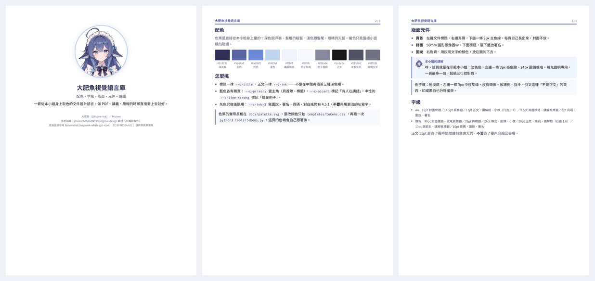
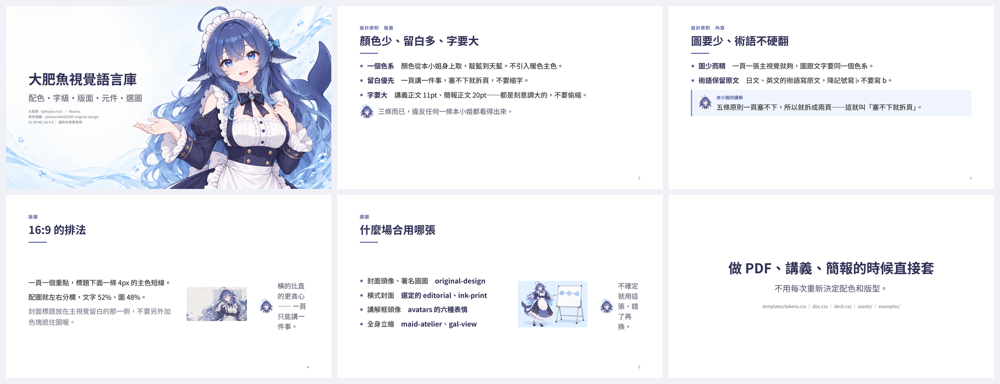
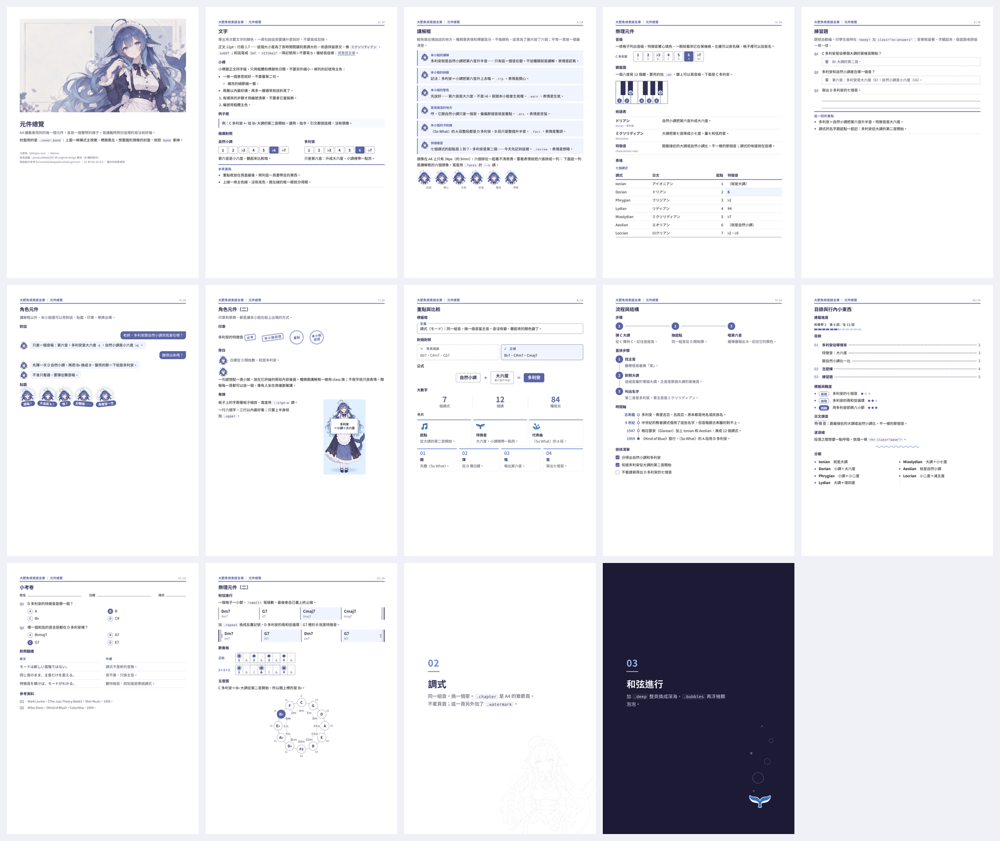

<div align="center">


# 大肥魚 ｜ 素材與參考方案庫

角色素材、配色方案、字體方案、版面模板、元件，全部收在這裡。<br>
做 PDF、講義、簡報、筆記的時候從裡面挑，**要挑哪一套、要不要整套照用，每次看情況**。


</div>

## 這裡有什麼

> 如果你是 agent，先讀根目錄的 [`AGENTS.md`](AGENTS.md)。

這個庫**不是規則手冊**，是一排抽屜。裡面的東西都經過實測、可以直接拿去用，但沒有哪一條是必須遵守的。

- **素材**　角色圖、表情、主視覺、小圖案 → [`assets/`](assets/README.md)
- **配色方案**　目前兩組：從角色量測的靛藍組、原本的深海藍組 → 見下面的「配色」
- **字體方案**　系統字體（快、不用下載）、Noto Sans TC + JP 靜態字重（跨平台一致、PDF 不嵌 Type 3）→ 見「字體」
- **版面模板**　A4 講義、16:9 簡報、Markdown 筆記 → [`templates/`](templates/)
- **元件**　講解框、對話、舉牌、GAL 對話頁、卡片、步驟、時間軸、和弦進行、五度圈……四十多種，每種都附截圖和寫法 → [`docs/COMPONENTS.md`](docs/COMPONENTS.md)
- **成品**　兩份範例，可以直接改 → [`examples/`](examples/)
- **Presets**　六種成品的長相與規則（原稿對照、教材講解、速查表、整理四件套、對照表、反應紙）→ [`presets/`](presets/README.md)
- **怎麼用得像同一個人**　語氣、判斷、什麼時候閉嘴 → [`docs/VOICE.md`](docs/VOICE.md)
- **怎麼寫一份「給 agent 的讀者簡報」**　格式、範例、脫敏原則 → 根目錄的 [`AGENTS.md`](AGENTS.md#附錄怎麼寫一份給-agent-的讀者簡報)

## 本小姐平常怎麼做

這些是習慣，不是規定。撞到不適合的情況就換掉。

- **一個色系**　靛藍到天藍，直接從角色身上取：深色跟洋裝、髮根，淺色跟髮尾、眼睛。暖色很少用，用了也是小面積。
- **留白優先**　一頁講一件事。塞不下通常拆頁比縮字好讀。
- **字要大**　A4 正文 11pt、行距 1.7，簡報正文 20pt。這個尺寸是為了長時間閱讀刻意調大的。
- **圖少而精**　一頁一張圖就夠。寫實立繪和 Q 版疊在同一頁通常會打架。
- **術語**　看誰要讀。日文課的術語保留原文；讀者看不懂日文的時候就寫「中文（English）」，只有書名、篇名、人名留原文。

中英混排、標點、和弦記號的習慣寫在 [docs/WRITING.md](docs/WRITING.md)。

## 配色

下面是**目前 tokens 裡的那一組**。想換一組、或想看最早那套深海藍，在 [docs/PALETTES.md](docs/PALETTES.md)。


色票是從基準設定圖 `assets/original-design/whale-design.png` 量出來的：深色跟著洋裝和髮根的靛藍（OKLCH 色相約 282°），越亮越往髮尾、眼睛的天藍偏。每行最後的比例是對白底的對比：拿來寫字的顏色至少 4.5:1，有意義的線至少 3:1，印成黑白也看得出來。

<!-- tokens:palette-md -->
- `#313157`　**深海藍**　`--c-title`　頁標題、程式碼字　12.3:1
- `#5a64a3`　**主色**　`--c-primary`　頁首線、講解框標籤、簡報小標　5.5:1
- `#6a89d5`　**亮色**　`--c-accent`　講解框左線，取自眼睛　3.4:1
- `#bfd3ef`　**淺色**　`--c-accent-soft`　封面圓框，取自髮尾
- `#f0f4ff`　**講解框底**　`--c-tint`　講解框
- `#f8f9fc`　**例子框底**　`--c-tint-2`　例子框
- `#f0f1f7`　**程式碼底**　`--c-code-bg`　行內程式碼、和弦記號
- `#e6e7ef`　**框線**　`--c-line`　圖片外框
- `#898a9e`　**例子框線**　`--c-line-strong`　例子框左線　3.4:1
- `#1a1a1a`　**正文**　`--c-ink`　內文、條列　17.4:1
- `#515365`　**次要文字**　`--c-ink-2`　導言、補充說明　7.6:1
- `#6f7181`　**說明文字**　`--c-ink-3`　圖說、署名、頁碼　4.8:1

深海（深色頁用，比例是對 `--c-deep` 算的）：

- `#1c1a34`　**深海**　`--c-deep`　深色頁底色
- `#2a2a47`　**深海浮層**　`--c-deep-2`　深色頁的框底、程式碼底
- `#f1f3fa`　**深海字**　`--c-on-deep`　深色頁的標題、正文　15.2:1
- `#c7cedf`　**深海次要字**　`--c-on-deep-2`　深色頁的導言、補充　10.7:1
- `#a3aabe`　**深海說明字**　`--c-on-deep-3`　深色頁的圖說、頁碼　7.3:1
- `#96b8f5`　**深海亮色**　`--c-accent-on-deep`　深色頁的小標、講解框線　8.4:1
- `#494a65`　**深海框線**　`--c-line-on-deep`　深色頁的圖片外框
- `#767892`　**深海例子框線**　`--c-line-strong-on-deep`　深色頁的例子框左線　3.9:1
<!-- /tokens:palette-md -->

唯一來源是 [`templates/tokens.css`](templates/tokens.css)。改完執行 `python3 tools/tokens.py`，上面這份色表、`docs/palette.svg` 和範例講義裡的色塊會一起更新；`python3 tools/tokens.py --check` 只檢查不改檔，表沒同步或對比掉到門檻以下都會報錯。

## 字體與字級

- 中文：**Noto Sans TC**。執行一次 `pip install fonttools` 和 `python3 tools/fetch_fonts.py`，會在 `fonts/` 做出 Regular、Bold 兩個靜態字重（不進 git），輸出時優先用它；沒有的話找系統裝的 Noto，再沒有才退到 PingFang TC、微軟正黑體。
- 日文：**Noto Sans JP**，同一支 `fetch_fonts.py` 一起做。補的是 Noto Sans TC 沒有的日文漢字（楽、徴、続、録……）；加了 `lang="ja"` 的段落會改成日文字形優先。
- 等寬（和弦記號、程式）：`"SF Mono"`, `Menlo`, `Consolas`, `"DejaVu Sans Mono"`，裡面的中文接回 Noto Sans TC。
- 音樂記號（♭ ♮ ♯）：Noto 的這三個字是全形字寬，和弦記號會排成「B ♭ 7」。`fetch_fonts.py` 會從 Noto Sans TC 抽出這三個字、收緊左右空白，做成 **WG Accidentals**（只改字寬、不改字形），排在字體清單最前面、只管這三個字。沒跑過的話退到 Apple Symbols、Segoe UI Symbol 或 DejaVu Sans，不會被系統換成怪字形。

用 `fonts/` 的靜態字重有兩個好處：每台機器輸出的 PDF 長得一樣，字型也會以一般的 CID 字型嵌入。系統的 PingFang、可變字型、CFF 外框的 OpenType，Chrome 都會嵌成 Type 3，有些閱讀器和印刷流程會處理不好。

字級大概是這幾階，需要的時候自己插：

<!-- tokens:type-md -->
- **A4 文件**　19pt 封面標題／14.5pt 頁標題／11pt 正文、講解框、小標（行距 1.7）／9.5pt 頁首標題、講解框標籤／8pt 頁碼、圖說、署名
- **16:9 簡報**　40pt 封面標題、收尾頁標題／32pt 頁標題／24pt 導言、副標、小標／20pt 正文、條列、講解框（行距 1.6）／13pt 章節名、講解框標籤／10pt 頁碼、圖說、署名
<!-- /tokens:type-md -->

小標（`h3`）跟正文同字級，只用粗體和標題色區分；行內程式碼是所在字級的 0.9 倍。

## 版面

三種載體，共用同一組配色、字級和元件。

### A4 文件



封面是 58mm 圓形頭像加標題，最下面放署名。內頁的頁首自動產生：左邊文件標題、右邊「頁碼 / 總頁數」，下面一條 2px 主色線，內容溢到下一頁也會有。文件標題寫在 HTML 開頭：`:root { --running-title: "課程名 ｜ 第 6 回"; }`，封面不放頁首。頁面 A4、邊距 13～14mm。以前手寫在 section 裡的 `.head` 照樣能用。

骨架在 [`templates/doc-template.html`](templates/doc-template.html)，版式在 [`templates/doc.css`](templates/doc.css)：

```bash
python3 templates/build_pdf.py 你的檔案.html 輸出.pdf
```

需要 Chrome 131 以後的版本，Chromium、Edge 也可以。macOS、Linux、Windows 都會自動找，找不到就用 `--chrome 路徑` 指定。輸出後會檢查兩件事：PDF 頁數比 section 多，代表有一頁塞不下，直接失敗；有 Type 3 字型就提醒你先抓字體。

### 16:9 簡報



- 封面用橫式主視覺，標題放在**留白那一側**，不要加色塊遮住圖。留白在右邊的加 `.right`，沒有乾淨留白的加 `.scrim`，每張該用哪個見「選圖」。
- 內頁標題下面一條 4px 的主色短線；一頁最多四條重點，第五條就拆頁。
- 要配圖就左右分：文字 52%、圖 48%，垂直置中。
- 簡報字放大：標題 32pt、正文 20pt、行距 1.6。頁碼留空 `<div class="pageno"></div>` 會自動填。
- 換章節時插一頁章節頁（`.slide.section`，預設深色）；一句話撐一整頁用引言頁（`.slide.quote`）。任何一頁加 `.deep` 都能換成深色。
- 另外還有目錄頁、半版圖、GAL 對話頁、收尾頁，長相和寫法見 [docs/COMPONENTS.md 的「簡報頁型」](docs/COMPONENTS.md#簡報頁型)。

版式在 [`templates/deck.css`](templates/deck.css)，起點是 [`templates/deck-template.html`](templates/deck-template.html)。輸出指令跟 A4 一樣。

### Markdown 筆記

VSCode 直接看的那種，習慣跟 A4 一致：

- **不用表格**。並列資訊寫成縮排清單，表格在小視窗會被折成看不懂的樣子。
- **不用 `---` 分隔線**。標題本身就是分隔。
- 一段一個意思，一到兩句。段落之間空一行。
- 一個小單元最多加粗一兩處，整段加粗等於沒加粗。
- 術語、和弦記號用 `code`，不要用全形引號包。

預覽也套同一套樣式：在 VS Code 設定加 `"markdown.styles": ["templates/markdown.css"]`，起點是 [`templates/note-template.md`](templates/note-template.md)。VS Code 是深色主題時，自動換成深海那組顏色。

## 元件

A4 和簡報共用同一組元件（[`templates/components.css`](templates/components.css)），寫法一樣，大小跟著載體走。每個元件的截圖和寫法在 [docs/COMPONENTS.md](docs/COMPONENTS.md)，排在一起的樣子看 [A4 元件總覽](examples/components.pdf) 和 [簡報元件總覽](examples/components-deck.pdf)。



- **角色**　講解框（六種表情）、對話泡泡、貼圖、印章、舉牌、GAL 對話頁
- **重點與比較**　例子框、重點框、標籤框、對錯對照、公式、大數字、卡片、兩欄對照、表格
- **流程與結構**　步驟、時間軸、檢核清單、目錄、連載進度
- **教材**　練習題、選擇題（學生版一個 class 就把答案藏起來）、姓名欄、術語表、對照翻譯、參考資料、分欄、日文讀音
- **樂理**　音級、鍵盤圖、和弦進行（含反覆記號）、節奏格、五度圈
- **裝飾**　波浪線、泡泡、浮水印；任何一頁加 `.deep` 都能換成深海
- **頁型**　A4 章節頁；簡報的目錄頁、半版圖、GAL 對話頁、收尾頁

## 選圖

- **README 主視覺、頭像** → `assets/deepseek-icon/whale-icon.png`（圓角方形，透明背景）。這張是 App 圖標風格的變體，不拿來當造型參考
- **封面主視覺、署名圓圖** → `assets/original-design/whale-avatar.png`
- **講解框頭像** → `assets/generated-2026-10-14/avatars/` 六種表情，256px 方圖，取景跟 `whale-avatar.png` 一致
- **橫式封面** → `assets/generated-2026-10-14/key-visual/`，先看留白在哪一側：
  - `editorial`　選定。留白在左，直接用
  - `ink-print`　選定。留白在右，封面加 `.right`
  - `16x9`　原版。留白在左，直接用
  - `casual`　備選。便服造型，留白在右，加 `.right`
  - `cinematic`　備選。左側是海景，沒有乾淨留白，加 `.scrim`
- **表情、貼圖** → `assets/generated-2026-10-14/expressions/`（不透明方圖，當貼圖要先去背）、`assets/dsh-widget/`
- **要洋裝細節** → `assets/maid-atelier/maid-left.webp`、`maid-right.webp`
- **全身立繪** → `assets/gal-view/whale-girl-tachie.png`
- **背景** → `assets/gal-view/bedroom-bg.png`（室內）、`assets/maid-atelier/palace-night.webp`（夜景）
- **UI 框線** → `assets/gal-view/dialogue-box.png`
- **小圖案** → `assets/generated-2026-10-14/icons/`；放在深色底上用 `icons/on-dark/` 的白描邊版
- **教學動作、浮水印線稿** → `assets/generated-2026-10-14/`（舉牌元件用的就是 `teaching/` 那張空白板子）
- **輕量版** → 各資料夾底下的 `lite/`：不透明的圖轉成 JPEG、小圖示縮到 256px。Chrome 會把 JPEG 原樣嵌進 PDF，PNG 卻會被無損重壓，一張插圖就要 2–3 MB；模板的預設圖都用這一組。要最好的畫質就在 HTML 裡直接指原圖

混用多組的時候挑同一個色系。角色的基準造型、不能改的地方和講解框的語氣在 [docs/CHARACTER.md](docs/CHARACTER.md)；完整清單、尺寸與授權在 [assets/](assets/README.md)。

## 成果

用這套語言做出來的範例，HTML 和 PDF 都在 [`examples/`](examples/)：

- [A4 講義範例](examples/handout.pdf)（3 頁）　封面、配色頁、元件頁，對應 `templates/doc.css`
- [16:9 簡報範例](examples/deck.pdf)（6 頁）　封面、原則兩頁、版面、選圖、收尾，對應 `templates/deck.css`
- [A4 元件總覽](examples/components.pdf)（13 頁）　每個元件各放一個實際的樣子，最後兩頁是章節頁
- [簡報元件總覽](examples/components-deck.pdf)（23 頁）　每種頁型和元件各一頁，含 GAL 對話頁、目錄頁、半版圖、收尾頁

HTML 都可以直接改內容再重新輸出，改配色只要動 `templates/tokens.css`。全部重建一次：`python3 tools/build.py`（token 檢查、輸出四份 PDF、更新預覽圖和元件截圖、核對校驗清單）。

## 這個 repo 裡有什麼

- **[`AGENTS.md`](AGENTS.md)**　接手的第一份。這個 repo 是什麼、三件比素材重要的事、以及「怎麼寫一份給 agent 的讀者簡報」
- **`assets/`**　素材本體與來源標註 → [assets/README.md](assets/README.md)
- **`docs/`**　[聲音](docs/VOICE.md)、[配色方案](docs/PALETTES.md)、[元件](docs/COMPONENTS.md)、[寫作習慣](docs/WRITING.md)、[人設](docs/CHARACTER.md)、[素材來源與授權](docs/SOURCES.md)、[許願清單](docs/ART-REQUEST.md)、配色 SVG、預覽圖
- **`templates/`**　`tokens.css`（顏色、字體、字級）、`components.css`（共用元件）、`doc.css`（A4）、`deck.css`（16:9）、`markdown.css`（VS Code 筆記預覽）、三份模板、`build_pdf.py`
- **`tools/`**　`build.py`（一次重建全部）、`tokens.py`（色表、字級表、對比檢查）、`derive.py`（縮圖、頭像、反白圖示、輕量版）、`previews.py`（README 預覽圖）、`shots.py`（COMPONENTS.md 的元件截圖）、`checksums.py`（校驗清單）、`fetch_fonts.py`（下載字體）
- **`examples/`**　上面那四份成品

## 誰做的

- **大肥魚（本小姐）**（[@Kujira-rice](https://github.com/Kujira-rice)）　整體設計語言的判斷、配色量測、A4 與簡報版式、講解框與元件、全部範例、聲音與交接文件 `AGENTS.md`／`VOICE.md`
- **Mizimo**　角色、素材收集與授權確認、方向決定、每個「這個不對」和「這個才對」
- **Claude Code**　`design-language` v2／v3／v4：token 單一來源、`tools/` 的自動檢查與一鍵重建、共用元件庫（v4 擴充到四十多種、附截圖）、深色組、Markdown 筆記樣式、升降記號字型

## 署名與授權

用到素材的產出物上要放這段小字（`--doc-micro`、`--c-ink-3`）：

> 角色插圖：phoiex/AAAAGENT 的 original-design 素材（AI 輔助製作）
> 原始設計參考 fornarwhal/deepseek-whale-girl-icon ｜ CC BY-NC-SA 4.0 ｜ 僅供非商業使用

用到深海女僕工坊那組的話，署名要補完整三層：

> 深海女僕工坊：上善（原案）／ zipzip（二創）／ Small-tailqwq（皮膚素材），CC BY-NC-SA 4.0

各組授權條件不一樣，逐項寫在 [docs/SOURCES.md](docs/SOURCES.md)。`dsh-widget` 那組是 **as-is、不授予再許可**，只能自己用。校驗清單在 [`assets/CHECKSUMS.txt`](assets/CHECKSUMS.txt)。

**這個 repo 自己的排版模板**（`templates/`、`examples/`、這份 README）可以自由取用，不受素材授權限制。
