# 元件

A4 講義和 16:9 簡報共用同一組元件，寫法一樣，字級和間距跟著載體走。下面每個元件都是一句用途、一張實際的樣子、一段可以直接抄的寫法。全部排在一起看：[A4 元件總覽](../examples/components.pdf)、[簡報元件總覽](../examples/components-deck.pdf)。

## 怎麼引用

- A4 連 `templates/doc.css`，簡報連 `templates/deck.css`。兩份都會自動載入 `tokens.css`（顏色、字體、字級）和 `components.css`（這頁的元件）。
- 頭像、舉牌、GAL 背景這些圖的路徑寫在 CSS 裡，所以 HTML 要連 repo 裡的 `templates/`，不要把 CSS 單獨複製出去。
- 想讓每台機器輸出的 PDF 都一樣，先跑一次 `python3 tools/fetch_fonts.py`（見 README 的「字體與字級」）。
- 這頁的圖是 `python3 tools/shots.py` 從兩份總覽截出來的，總覽改了就重跑。`docs/preview/c/` 裡會有全部元件的截圖（A4 和簡報各一套），下面只挑主要的放；沒放上來的直接翻 [A4 元件總覽](../examples/components.pdf) 或 [簡報元件總覽](../examples/components-deck.pdf)。

## 一覽

- **角色**　[講解框](#講解框) · [對話](#對話) · [貼圖](#貼圖) · [旁白](#旁白) · [印章](#印章) · [舉牌](#舉牌) · [GAL 對話頁](#gal-對話頁)
- **重點與比較**　[例子框](#例子框) · [重點框](#重點框) · [標籤框](#標籤框) · [對錯對照](#對錯對照) · [公式](#公式) · [大數字](#大數字) · [卡片](#卡片) · [兩欄對照](#兩欄對照) · [表格](#表格)
- **流程與結構**　[步驟](#步驟) · [時間軸](#時間軸) · [檢核清單](#檢核清單) · [目錄](#目錄) · [連載進度](#連載進度)
- **行內**　[行內程式碼](#行內程式碼) · [標籤與難度](#標籤與難度) · [日文讀音](#日文讀音)
- **教材**　[練習題](#練習題) · [選擇題](#選擇題) · [姓名欄](#姓名欄) · [術語表](#術語表) · [對照翻譯](#對照翻譯) · [參考資料](#參考資料) · [分欄](#分欄)
- **樂理**　[音級](#音級) · [鍵盤圖](#鍵盤圖) · [和弦進行](#和弦進行) · [節奏格](#節奏格) · [五度圈](#五度圈)
- **裝飾**　[波浪線](#波浪線) · [泡泡](#泡泡) · [浮水印](#浮水印) · [深海](#深海)
- **頁型**　[紙本頁型](#紙本頁型) · [簡報頁型](#簡報頁型)

## 角色

### 講解框

鯨魚娘出場說話的地方。種類用表情和標籤分，不換顏色。


```html
<div class="whale tip">
  <span class="av"></span>
  <div class="txt"><span class="who"></span>記法：多利安＝小調把第六音升上去喵。</div>
</div>
```

- 種類：（不加）講解・認真　`.tip` 訣竅・開心　`.warn` 警告・生氣　`.mix` 易混・苦惱　`.fact` 冷知識・驚訝　`.review` 複習・想睡
- `<span class="av"></span>` 會照種類換表情；要用別張圖就寫 ``。
- `<span class="who"></span>` 留空會填「本小姐的訣竅」這類預設標籤，寫了字就用你寫的。
- 口吻參考 [CHARACTER.md 的「講解框的語氣」](CHARACTER.md#講解框的語氣)。

### 對話

一問一答的聊天泡泡：鯨魚娘在左，讀者在右。


```html
<div class="chat">
  <p class="me">老師，多利安跟自然小調到底差在哪？</p>
  <p class="tip">只差一個音喵：第六音。</p>
  <p>先彈一次 D 自然小調，再把 B♭ 換成 B。</p>
</div>
```

- 不加 class 是鯨魚娘（認真）；表情跟講解框一樣用 `.tip` `.warn` `.mix` `.fact` `.review` 換。`.me` 是讀者。
- 同一個表情連講兩句，第二句不重複頭像；換了表情就會再出現一次。

### 貼圖

一張圓臉配一句短話，像聊天軟體的貼圖。


```html
<span class="sticker warn">不准寫 b！</span>
```

- 表情跟講解框一樣用 class 換。一排好幾張時會自動左右交錯傾斜。
- 加 `.pin` 貼到這一頁的右上角；臉的大小用 `--s` 調，例如 `style="--s: 8em"`。

### 旁白

一句感想配一張小臉，放在它評論的那段內容後面。簡報每一頁都可以放一個，讀起來像有人坐在旁邊跟著講，而不是只有投影片。


```html
<p class="aside tip">白鍵從 D 開始數，就是多利安。</p>
<p class="aside review"></p>          <!-- 留空就只放表情 -->
```

- 種類跟講解框一樣：不加是講解，`tip` 訣竅、`warn` 警告、`mix` 易混、`fact` 冷知識、`review` 複習。
- 臉的大小跟著 `--av`（A4 34px、簡報 56px），要換別張圖就自己放 ``。
- 它會跟著內容排；放進 `.body` 的結尾就會貼著那段內容，放在 section 直屬子元素會被推到頁尾。

### 印章

斜斜蓋在標題旁邊或角落。


```html
<h2>多利安 <span class="stamp">必考</span></h2>
<span class="stamp"></span>             <!-- 留空就是「本小姐認證」 -->
<span class="stamp round">重點</span>   <!-- 圓章，兩三個字 -->
```

### 舉牌

鯨魚娘舉著一塊白板，字寫在板子上。

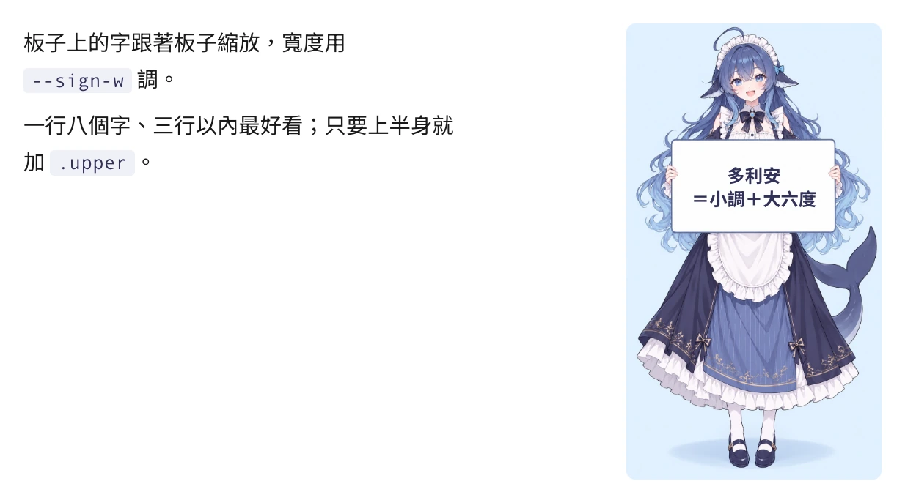

```html
<div class="sign"><p>多利安<br>＝小調＋大六度</p></div>
```

- 寬度用 `--sign-w` 調（A4 預設 46mm、簡報 300px），字跟著板子一起縮放。一行八個字、三行以內最好看。
- 加 `.upper` 只露上半身，簡報上比較好放（例子見下面 [簡報頁型](#簡報頁型) 的左文右圖）。

### GAL 對話頁

簡報專用。臥室背景、立繪、對話框都預設好了，只要寫名字和台詞；要出選項就在上面加一組 `.menu`。

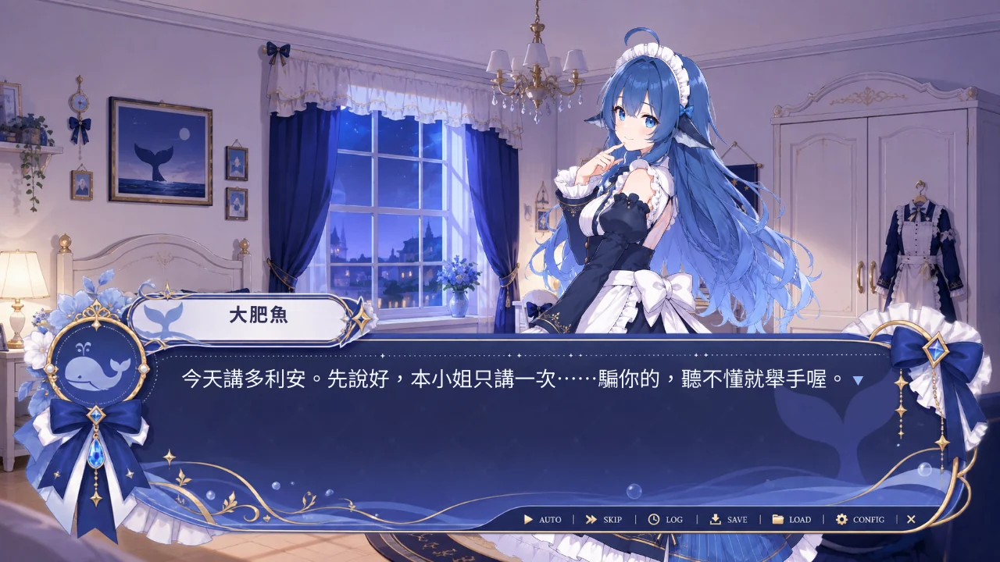 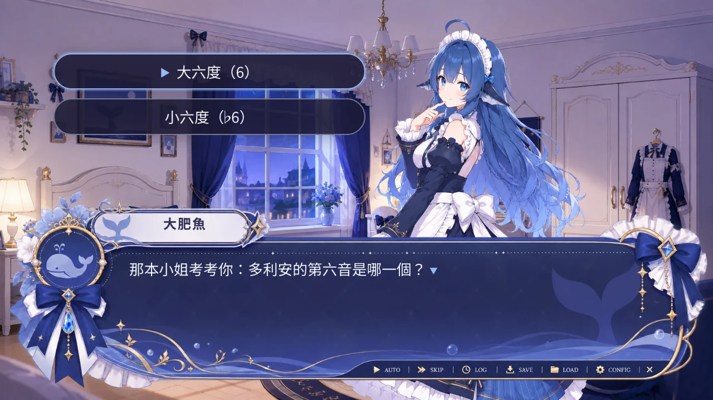

```html
<section class="slide gal">
  <ol class="menu"><li class="pick">大六度（6）</li><li>小六度（♭6）</li></ol>
  <div class="say"><b>大肥魚</b><p>那本小姐考考你：多利安的第六音是哪一個？</p></div>
</section>
```

- 台詞放得下三行。`.pick` 是選中的那個選項。
- 換背景放 ``，換立繪放 ``；加 `.left` 人站到左邊，選項跟著換到右邊。
- 這頁用的是 `gal-view` 那組素材，授權狀況見 [SOURCES.md](SOURCES.md) 的 gal-view 一節。

## 重點與比較

### 例子框

譜例、指令、引文這些「不是正文」的東西。沒有頭像，一頁可以有好幾個。

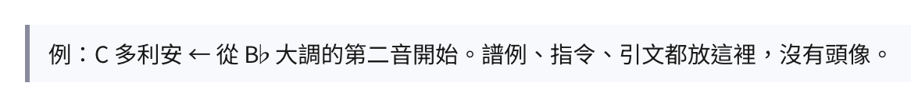

```html
<div class="ex">例：C 多利安 ← 從 B♭ 大調的第二音開始。</div>
```

### 重點框

頁尾整理這一頁要帶走的東西：上緣一條主色線、沒有底色。

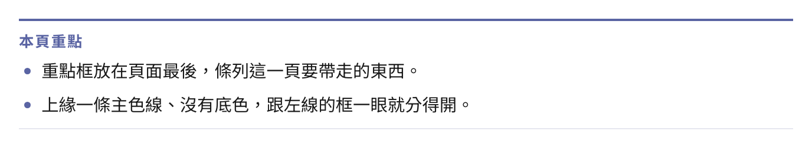

```html
<div class="summary" data-label="這一回的重點">
  <ul>
    <li>多利安＝自然小調把第六音升半音。</li>
  </ul>
</div>
```

- 標籤預設「本頁重點」，`data-label` 可以換。

### 標籤框

外框加一個壓在框線上的標籤，放定義、公式、規則原文這種要框起來的東西。

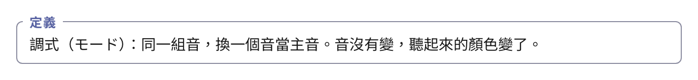

```html
<div class="box" data-label="定義">調式：同一組音，換一個音當主音。</div>
```

- 不寫 `data-label` 就是「定義」。

### 對錯對照

左邊常見的錯，右邊對的。

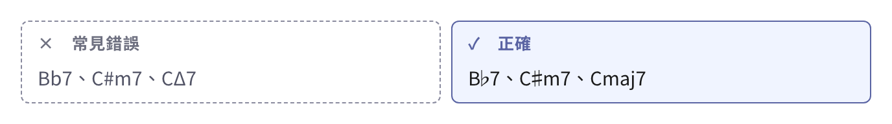

```html
<div class="vs">
  <div class="no">Bb7、C#m7、CΔ7</div>
  <div class="yes">B♭7、C♯m7、Cmaj7</div>
</div>
```

- 標籤預設「× 常見錯誤」「✓ 正確」，在那一格加 `data-label="…"` 換掉。

### 公式

「A ＋ B ＝ C」的記法。


```html
<div class="formula">
  <span>自然小調</span><i>＋</i><span>大六度<small>第六音升半音</small></span><i>＝</i><span class="key">多利安</span>
</div>
```

- `<span>` 是一塊，`<i>` 是符號；`.key` 實心填色，`<small>` 補一行小字。

### 大數字

幾個數字一字排開，下面一行說明。

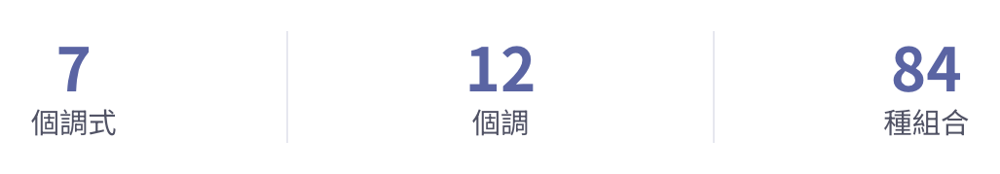

```html
<div class="stats">
  <div><b>7</b>個調式</div>
  <div><b>12</b>個調</div>
  <div><b>84</b>種組合</div>
</div>
```

- 單位寫在數字後面的 `<small>`：`<b>45<small>分</small></b>`。

### 卡片

並列的幾個重點，一排自動排二到四張。

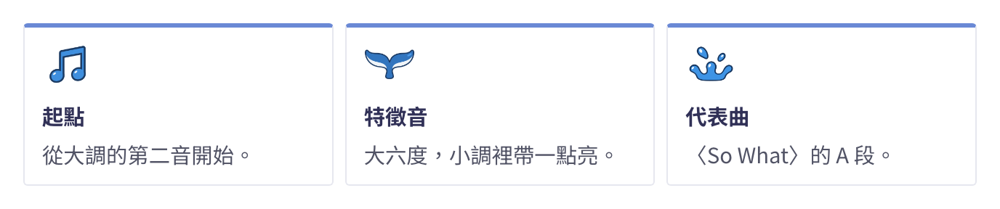

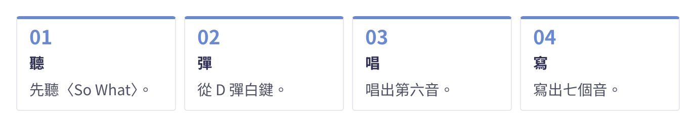

```html
<div class="cards">
  <div><h3>起點</h3><p>從大調的第二音開始。</p></div>
  <div><span class="n">02</span><h3>特徵音</h3><p>大六度。</p></div>
</div>
```

- 頂端可以放 ``（小圖示）或 `<span class="n">`（編號），也可以都不放。
- 小圖示在 `assets/generated-2026-10-14/icons/lite/`，深色頁用 `icons/on-dark/lite/`。

### 兩欄對照

兩個東西並排比較。兩欄用同樣的小標、同樣的元件，差別最好比。

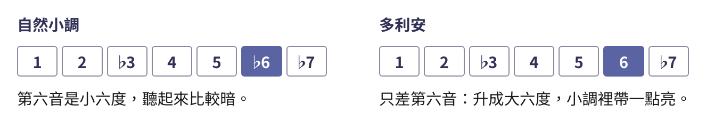

```html
<div class="cols">
  <div><h3>自然小調</h3>…</div>
  <div><h3>多利安</h3>…</div>
</div>
```

### 表格

並列比較：表頭下一條主色線，列與列之間細線。

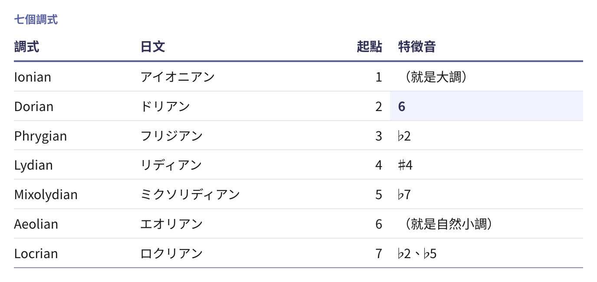

```html
<table>
  <caption>七個調式</caption>
  <thead><tr><th>調式</th><th class="num">起點</th><th>特徵音</th></tr></thead>
  <tbody>
    <tr><td>Dorian</td><td class="num">2</td><td class="key">6</td></tr>
  </tbody>
</table>
```

- 數字欄加 `.num` 靠右；要指出的格子加 `.key`（粗體加淡底，印成黑白靠粗體辨認）。

## 流程與結構

### 步驟

有先後順序的幾步：圓圈編號自動產生，中間用線連起來。

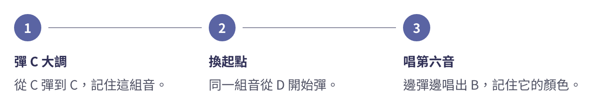

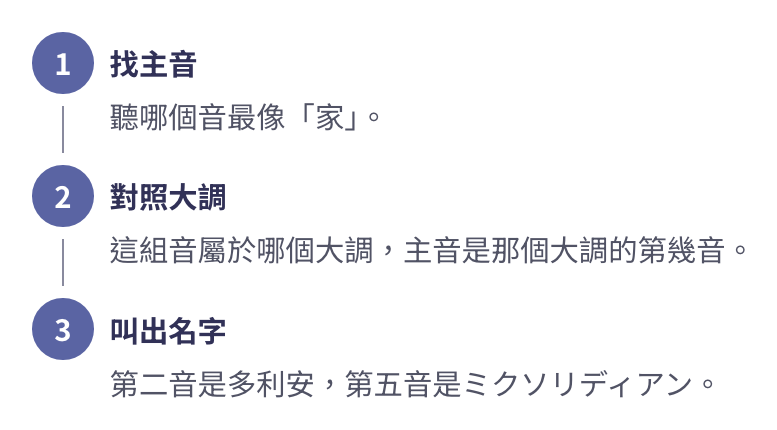

```html
<ol class="steps">
  <li><h3>彈 C 大調</h3><p>從 C 彈到 C，記住這組音。</p></li>
  <li><h3>換起點</h3><p>同一組音從 D 開始彈。</p></li>
  <li><h3>唱第六音</h3><p>邊彈邊唱出 B。</p></li>
</ol>
```

- 預設橫排；字比較多就加 `.down` 改直排。

### 時間軸

一條線串起幾個時間點。

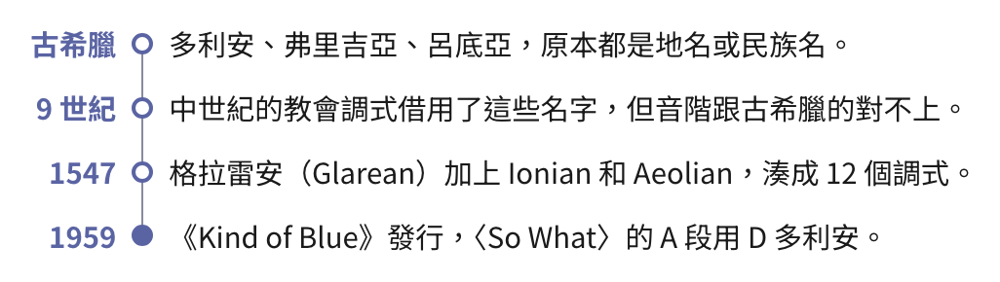

```html
<ol class="timeline">
  <li><time>1547</time>格拉雷安加上 Ionian 和 Aeolian，湊成 12 個調式。</li>
  <li class="key"><time>1959</time>《Kind of Blue》發行，〈So What〉的 A 段用 D 多利安。</li>
</ol>
```

- `<time>` 寫年份、日期、第幾回都行；`.key` 那一點實心。左欄寬度用 `--when` 調。
- 橫排加 `.across`，簡報上好用。

### 檢核清單

方框留給讀者自己勾，`.done` 已經打勾。

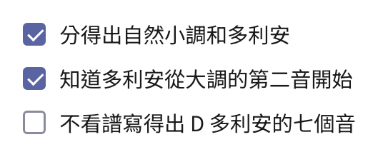

```html
<ul class="checklist">
  <li class="done">分得出自然小調和多利安</li>
  <li>不看譜寫得出 D 多利安的七個音</li>
</ul>
```

### 目錄

編號、標題、點點引線、頁碼。

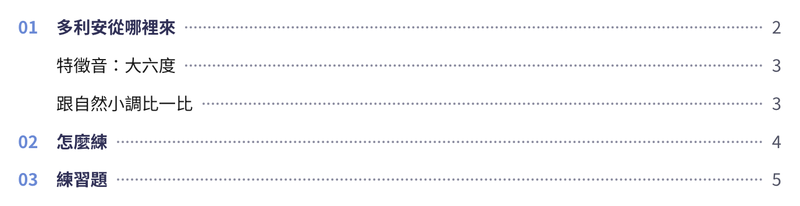

```html
<ol class="toc">
  <li><a href="#origin">多利安從哪裡來</a><span>2</span></li>
  <li class="sub"><a href="#sixth">特徵音：大六度</a><span>3</span></li>
  <li><a href="#practice">怎麼練</a><span>4</span></li>
</ol>
```

- 編號和引線自動補；頁碼自己寫（Chrome 算不出跨頁的頁碼）。`.sub` 是縮一層的小節，不編號。
- 簡報的目錄頁見 [簡報頁型](#簡報頁型)。

### 連載進度

第幾回／全幾回，一格一回。

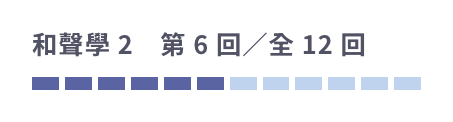

```html
<div class="series" style="--n: 6; --of: 12">和聲學 2　第 6 回／全 12 回</div>
```

## 行內

### 行內程式碼

和弦記號、級數、術語、檔名放 `<code>`，不會被拆到兩行。

```html
和弦寫成 <code>Im7</code>、<code>♭IIImaj7</code>
```

### 標籤與難度

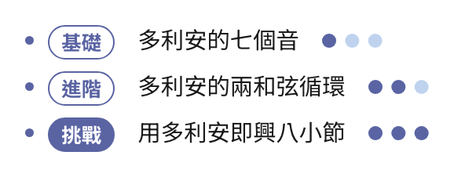

```html
<span class="tag">基礎</span> <span class="tag solid">挑戰</span>
<span class="level" style="--n: 2"></span>            <!-- 三個點亮兩個 -->
<span class="level" style="--n: 4; --of: 5"></span>   <!-- 五個點亮四個 -->
```

### 日文讀音

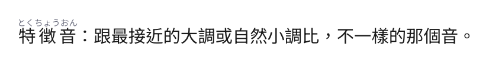

```html
<ruby lang="ja">特徴音<rt>とくちょうおん</rt></ruby>
```

- 有 `lang="ja"` 的元素會先用日文字形：同一個漢字，日文和繁中的寫法有時不一樣。

## 教材

### 練習題

題號自動編成 Q1、Q2……

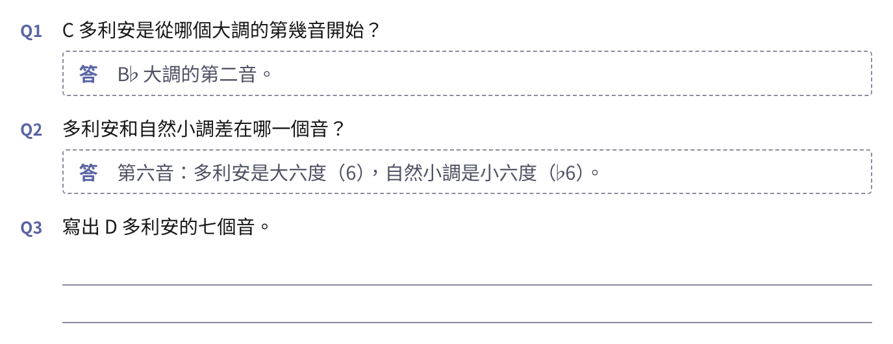

```html
<ol class="quiz">
  <li>C 多利安是從哪個大調的第幾音開始？
    <div class="answer">B♭ 大調的第二音。</div>
  </li>
  <li>寫出 D 多利安的七個音。
    <div class="lines" style="--n: 2"></div>
  </li>
</ol>
```

- `.answer` 是答案框；`.lines` 是給學生寫字的橫線，`--n` 是幾條。
- 印學生版：在 `<body>` 加 `class="no-answers"`。答案框留著、字藏起來，版面跟老師版一模一樣。

### 選擇題

選項代號 A B C D 自動編，兩欄排。

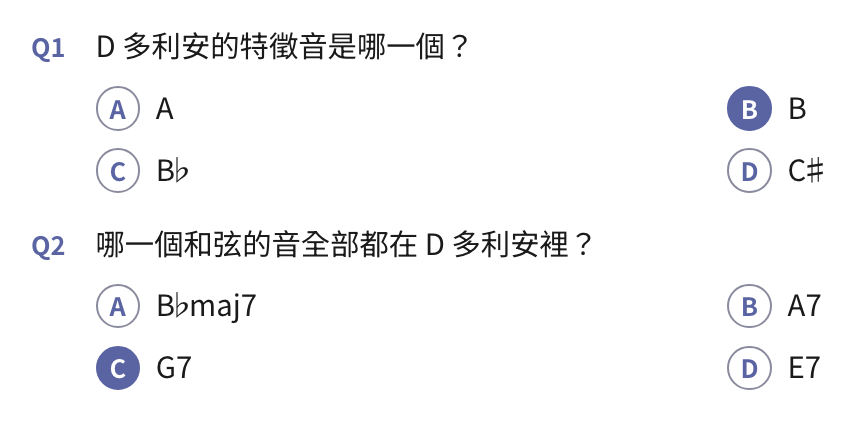

```html
<ol class="choices">
  <li>A</li><li class="correct">B</li><li>B♭</li><li>C♯</li>
</ol>
```

- 可以直接放進練習題的 `<li>` 裡。`.correct` 是答案，學生版不標出來。

### 姓名欄

學習單、小考卷的抬頭。

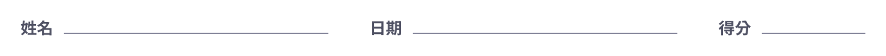

```html
<div class="fields"><span>姓名</span><span>日期</span><span class="short">得分</span></div>
```

### 術語表

原文、另一種寫法、中文說明，一行一個術語。

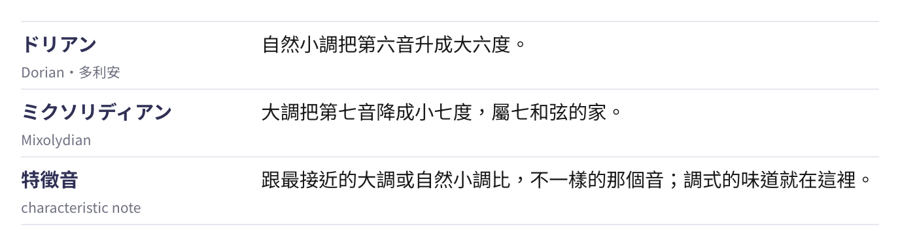

```html
<dl class="terms">
  <dt>ドリアン<span>Dorian・多利安</span></dt><dd>自然小調把第六音升成大六度。</dd>
</dl>
```

### 對照翻譯

原文和翻譯兩個一組，左右對成一列。

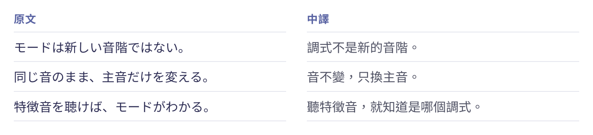

```html
<div class="bilingual">
  <h3>原文</h3><h3>中譯</h3>
  <p lang="ja">モードは新しい音階ではない。</p><p>調式不是新的音階。</p>
</div>
```

- 最上面的兩個 `<h3>` 是欄名，可以不寫。

### 參考資料

編號自動寫成 [1] [2]。

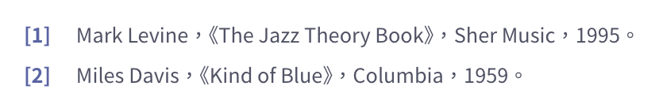

```html
<ol class="refs">
  <li>Mark Levine，《The Jazz Theory Book》，Sher Music，1995。</li>
</ol>
```

### 分欄

條列、術語、短段落排成兩欄省空間。

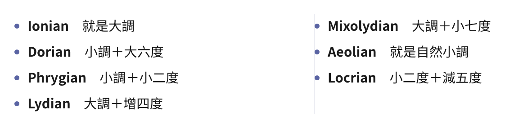

```html
<ul class="flow">
  <li><b>Ionian</b>　就是大調</li>
  <li><b>Dorian</b>　小調＋大六度</li>
  …
</ul>
```

- 三欄寫 `style="--cols: 3"`。

## 樂理

### 音級

一排格子列出音級，特徵音實心填色。

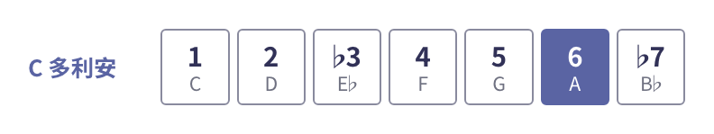

```html
<div class="degrees" data-label="C 多利安">
  <span>1<small>C</small></span><span>2<small>D</small></span><span>♭3<small>E♭</small></span>
  <span>4<small>F</small></span><span>5<small>G</small></span><span class="key">6<small>A</small></span><span>♭7<small>B♭</small></span>
</div>
```

- `data-label` 是左邊的名稱，`<small>` 寫音名，兩個都可以不寫。

### 鍵盤圖

一個八度寫 12 個 `<i>`，照半音順序：C、C♯、D、D♯、E、F、F♯、G、G♯、A、A♯、B。

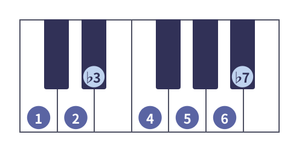

```html
<div class="keys">
  <i class="on">1</i><i></i><i class="on">2</i><i class="on">♭3</i><i></i><i class="on">4</i>
  <i></i><i class="on">5</i><i></i><i class="on">6</i><i class="on">♭7</i><i></i>
</div>
```

- 亮的鍵加 `.on`，鍵上出現一個圓點，裡面可以寫標籤（音級或音名）。
- 兩個八度以上：每 12 個鍵用 `<span class="oct">…</span>` 包起來，排在同一個 `.keys` 裡。
- 顏色固定鋼琴的黑白，放在深色頁上也不反轉。

### 和弦進行

一個格子一小節，最後自動畫終止線。

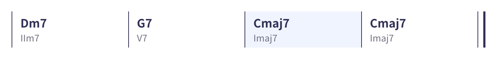

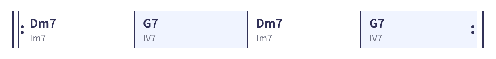

```html
<div class="prog">
  <span>Dm7<small>IIm7</small></span><span>G7<small>V7</small></span>
  <span class="key">Cmaj7<small>Imaj7</small></span><span>Cmaj7<small>Imaj7</small></span>
</div>
```

- `<small>` 寫級數；`.key` 把那一小節標出來；兩個和弦擠一小節就寫在同一個 `<span>`。
- 加 `.repeat` 頭尾換成反覆記號。

### 節奏格

一個 `<span>` 一拍，裡面每個 `<i>` 是一格細分。

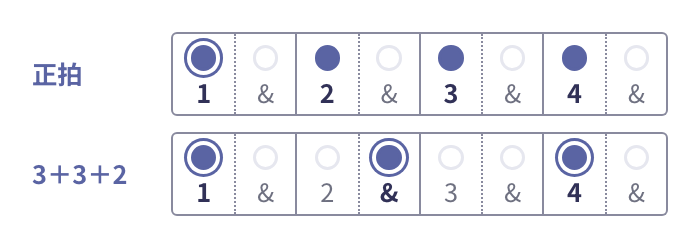

```html
<div class="beats" data-label="3＋3＋2">
  <span><i class="on accent">1</i><i>&amp;</i></span>
  <span><i>2</i><i class="on accent">&amp;</i></span>
  <span><i>3</i><i>&amp;</i></span>
  <span><i class="on accent">4</i><i>&amp;</i></span>
</div>
```

- `<i>` 裡寫數拍的字（`1 & 2 &`、`1 e & a` 都行）。`.on` 是要彈的格子，`.accent` 多一圈重音。

### 五度圈

十二個調照五度排一圈，關係小調在內圈，調號在圈外。

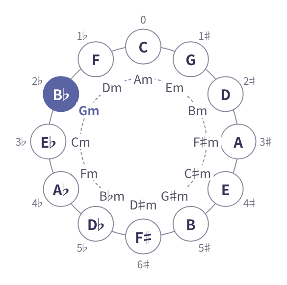

```html
<ol class="fifths">
  <li data-sig="0">C<small>Am</small></li>
  <li data-sig="1♯">G<small>Em</small></li>
  <!-- ……順時針排滿 12 個 -->
  <li class="key" data-sig="2♭">B♭<small>Gm</small></li>
  <li data-sig="1♭">F<small>Dm</small></li>
</ol>
```

- 大調寫在 `<li>`、關係小調寫在 `<small>`、調號寫在 `data-sig`（可以不寫）；`.key` 標出現在講的調。
- 大小用 `--fifths-r`（半徑）和 `--fifths-d`（圓圈直徑）調。
- 12 個 `<li>` 的完整寫法抄 [examples/components.html](../examples/components.html)。

## 裝飾

### 波浪線

段落之間的裝飾分隔線，顏色跟著亮色走，深色頁會自動換。

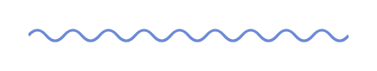

```html
<hr class="wave">
```

- 波的大小用 `--r` 調，線寬跟著等比例變。

### 泡泡

在 section 加 `.bubbles`，右下角浮起幾顆泡泡。章節頁、封面、收尾頁用起來最自然。


```html
<section class="slide end bubbles">…</section>
```

- 泡泡跟浮水印用的是同一個位置，兩個擇一。

### 浮水印

在 section（或任何一個框）加 `.watermark`，右下角淡淡印一張線稿，不會蓋到字。

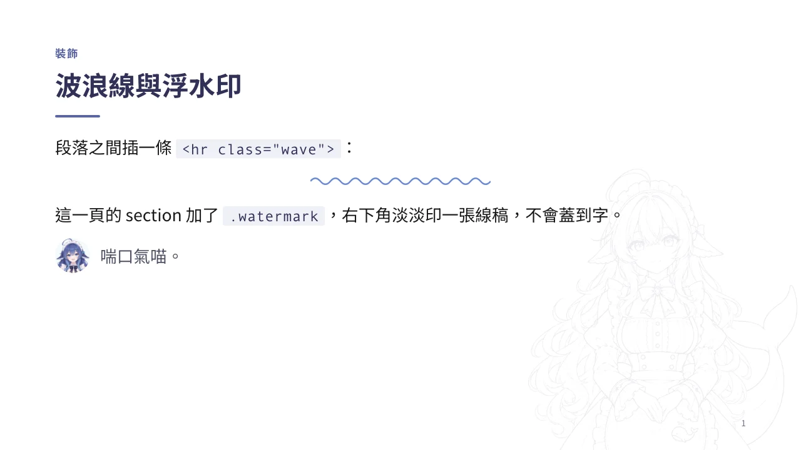

```html
<section class="slide watermark">…</section>
```

- A4 用在章節頁最自然：`<div class="chapter watermark">`（有線稿就不放尾巴）。

### 深海

在任何容器加 `.deep`，裡面的元件會自動換成深海那組顏色，不用改寫。

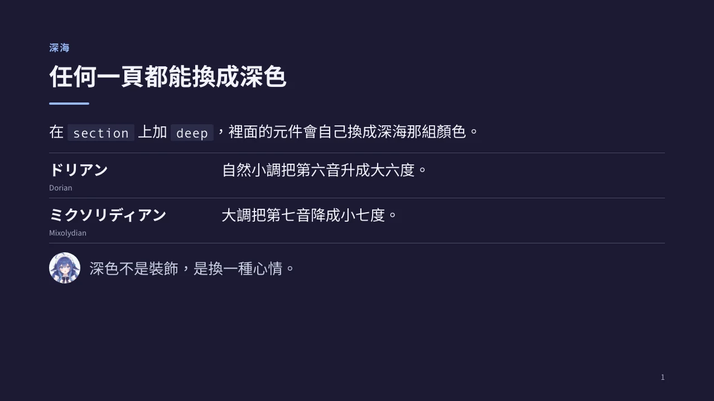 

- 簡報的章節頁預設就是深色。整份簡報都要深色，就在 `<body>` 加 `class="deep"`；封面上的字不會跟著背景圖自動換色，深色簡報的封面記得加 `.scrim`。
- VS Code 是深色主題時，Markdown 預覽也會自動換成深海。
- 鍵盤圖、講解框的頭像、舉牌和 GAL 對話框都是畫好的圖，不變色。

## 頁型

### 紙本頁型


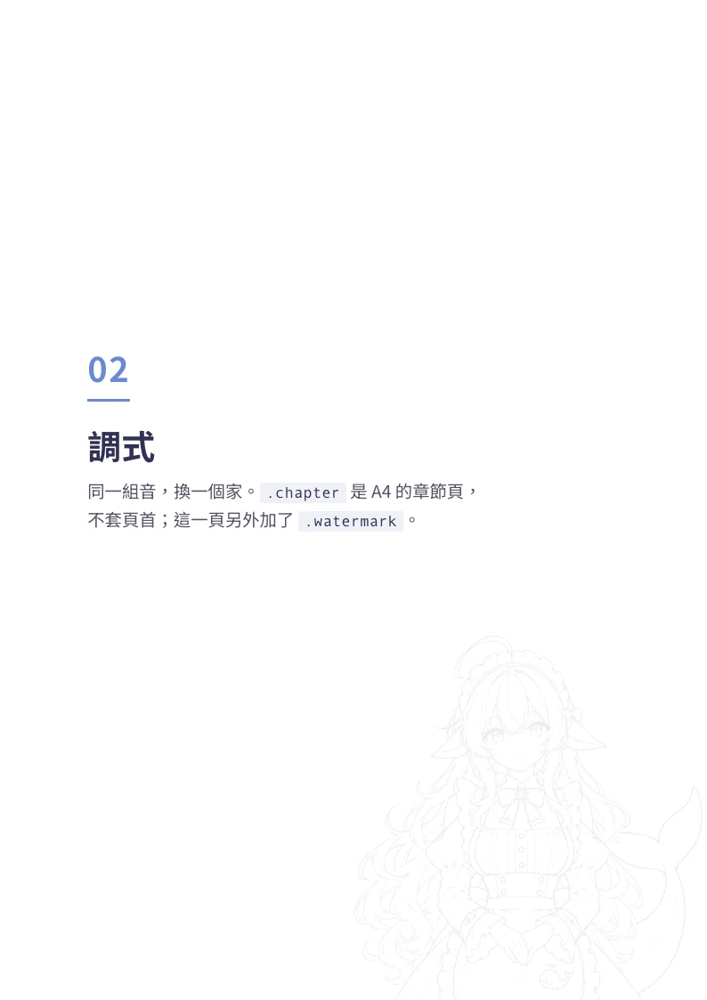 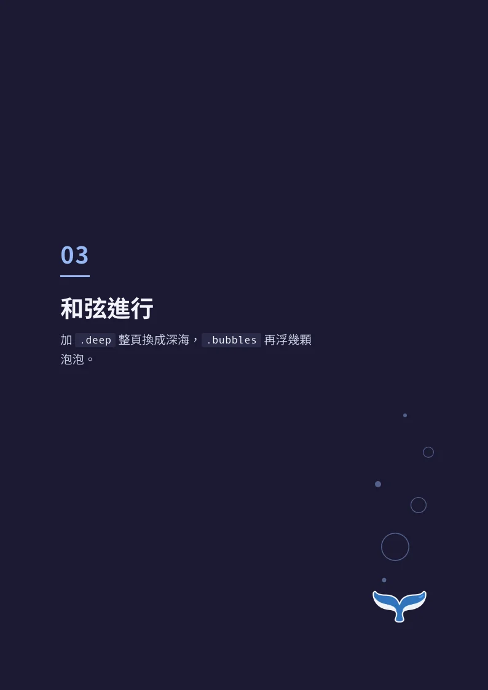

- **封面**　`.cover`：58mm 圓形頭像、標題置中。`.cover.band`：上面一條橫式主視覺、標題靠左。
- **章節頁**　`.chapter`：大編號、章名、一句話，不套頁首。加 `.deep` 整頁深色（滿版），`.bubbles` 加泡泡，`.watermark` 換成線稿。
  **什麼時候用**：十頁以上、或分成好幾章的長文檔，每換一章就插一頁，讓眼睛有地方休息，翻的時候也知道自己走到哪了。三、五頁的短文件不要用，插了反而空。
- **一般頁**　一個 `<section class="page">` 一頁，頁首（文件標題、頁碼）自動產生，標題寫在 `:root` 的 `--running-title`。
- **紙張**　預設 A4 直向。橫向、A5、Letter 都只是改 `doc.css` 裡 `--paper` 和 `--page-h` 兩個變數；整份一起換，`@page` 讀不到個別元素的變數。橫向之後一行會變很長，正文調大或分兩欄。

```html
<section class="page">
  <div class="chapter deep bubbles">
    <div class="num">03</div>
    <h2>和弦進行</h2>
    <p class="lede">一句話說這一章要做什麼。</p>
  </div>
</section>
```

### 簡報頁型

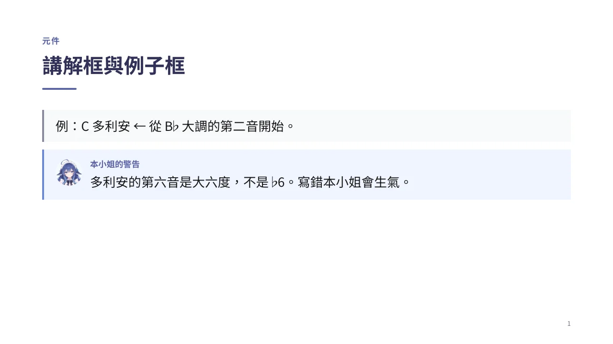 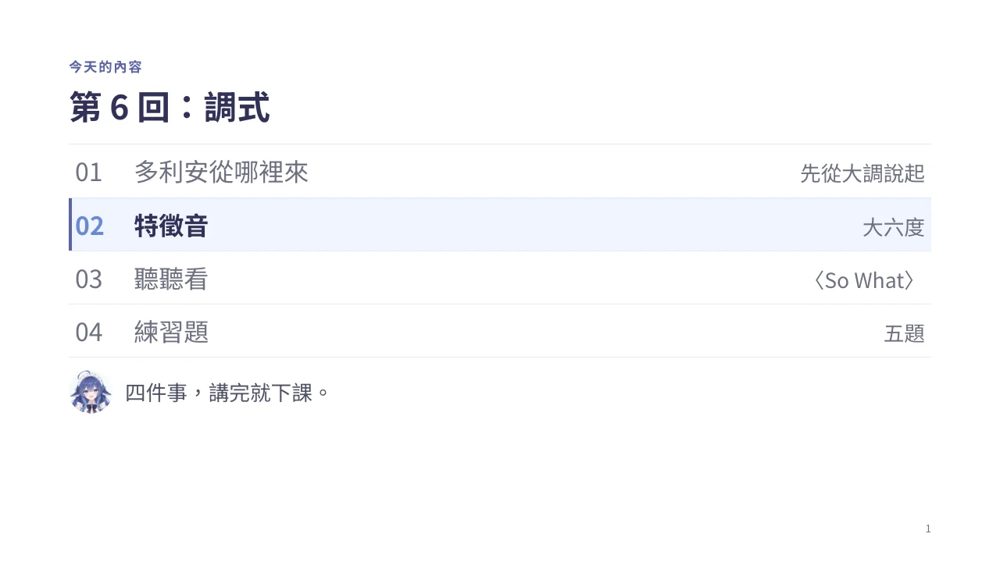

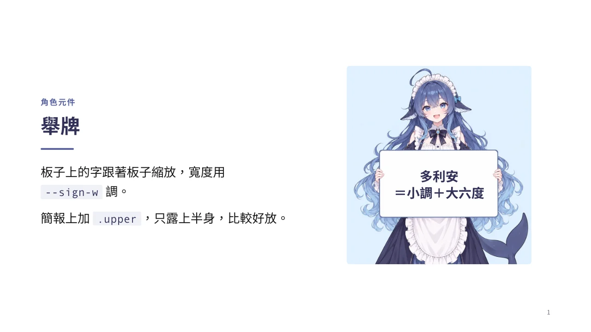 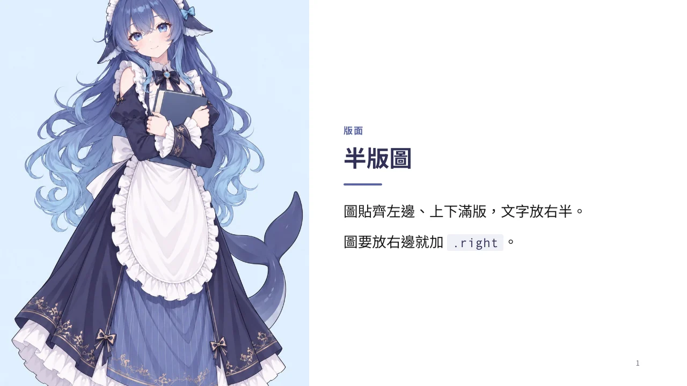

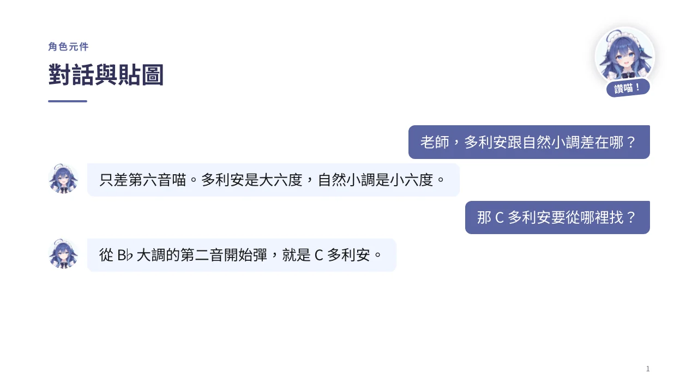 

- **一般頁**　`.kicker` 章節名、`h2` 標題、`.rule` 短線、`.body` 內容，`.pageno` 留空自動填頁碼。
- **目錄頁**　`.slide.agenda`：每段一個 `<li>`，`<small>` 補一句，`.now` 標出現在講到哪裡，其他段落自動變淡。
- **左文右圖**　`.two-col`：文字 52%、圖 48%，垂直置中。
- **半版圖**　`.slide.split`：第一張 `` 貼齊左邊、上下滿版，文字放右半；`.right` 圖在右。適合開場（一張大圖先把人拉進來）、換新主題、或講一個動作 —— 文字只放一兩句，圖自己會說話。
- **章節頁**　`.slide.section`：`.num` 章節號、`h2` 章名、`.lede` 一句話。預設深色、右下角有尾巴；`.light` 淺色，`.bubbles` 加泡泡。
- **引言頁**　`.slide.quote`：`blockquote` 一句話撐一整頁，出處寫在 `.cite`。
- **GAL 對話頁**　見上面的 [GAL 對話頁](#gal-對話頁)。
- **收尾頁**　`.slide.end`：上面自動放一張開心的臉，署名寫在 `.credit`；`` 可以換圖。
- **滿版圖**　`figure.full`：圖填滿標題下面的空間。**置中頁**　`.center`：標題和一句話置中。
- **封面**　`.slide.cover` 疊在主視覺上。留白在右的圖加 `.right`，沒有乾淨留白的加 `.scrim`，疊在暗部加 `.dark`，見 [README 的「選圖」](../README.md#選圖)。

```html
<section class="slide agenda">
  <div class="kicker">今天的內容</div>
  <h2>第 6 回：調式</h2>
  <ol>
    <li>多利安從哪裡來<small>先從大調說起</small></li>
    <li class="now">特徵音<small>大六度</small></li>
    <li>練習題</li>
  </ol>
  <div class="pageno"></div>
</section>

<section class="slide split">
  
  <div class="kicker">版面</div>
  <h2>半版圖</h2>
  <p>圖貼齊左邊、上下滿版，文字放右半。</p>
</section>

<section class="slide end bubbles">
  <h2>今天就到這裡喵</h2>
  <p class="lede">下一回：リディアン（Lydian）</p>
  <p class="credit">大肥魚（@Kujira-rice）／ Mizimo<br>角色插圖：phoiex/AAAAGENT original-design<br>CC BY-NC-SA 4.0 ｜ 僅供非商業使用</p>
</section>
```

## Markdown 筆記

- 在 VS Code 設定加 `"markdown.styles": ["templates/markdown.css"]`，預覽就會套用同一組配色和字體。
- 起點是 [`templates/note-template.md`](../templates/note-template.md)。引用（`>`）長得跟例子框一樣。
