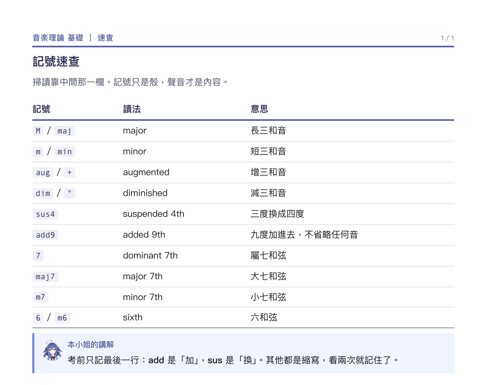

# 速查表（cheat-sheet）

**考前只看這一張。** 一到兩頁，掃過去就好。

## 什麼時候用

- 已經讀過講義，只是記不住名字跟對應。
- 考試前十分鐘。
- 片假名、術語、公式、指令這種「查得到就贏」的東西。

## 成品長相



一到兩頁，表格為主：

```
┌──────────────────────────────────┐
│ 片假名速查                        │
│ 掃讀靠英文那一欄。片假名只是殼。    │ ← 導言，一句話
│ ┌────────┬──────────┬────────┐  │
│ │ 片假名  │ 英文      │ 中文    │  │
│ ├────────┼──────────┼────────┤  │
│ │ モード  │ mode     │ 調式    │  │
│ │ ドリアン│ Dorian   │ 多利安  │  │
│ └────────┴──────────┴────────┘  │
│ ┌──────────────────────────────┐ │
│ │ 本小姐的講解：一句真心話        │ │ ← 最後才放
│ └──────────────────────────────┘ │
└──────────────────────────────────┘
```

- 表格不超過三欄；超過就拆成兩張表。
- 最後放一個講解框，只寫一句話。

## 參照

- [`examples/components.pdf`](../../examples/components.pdf)　表格、術語表、標籤這幾種元件的長相。
- 真實成品：1 頁，兩張表 ＋ 一句吐槽。用完就丟，不要捨不得。

## 規則

1. **只放「看兩秒就過」的東西。** 需要想的，不屬於這裡。
2. **一頁不超過三十列。** 超過就分頁，或砍掉不考的。
3. **欄位固定。** 原文｜英文｜中文，或 記號｜意思。不要每張表換一種排法。
4. **不要解釋，只給對應。** 「調式」兩個字就夠，不要寫「調式是一種…」。
5. **講解框只放一句。** 可以是吐槽，可以是提醒，不要變成第二份講義。

## 不做

- 不要放例題、推導、長句。
- 不要重新解釋概念——那是講義的事。
- 不要三欄以上硬塞；擠在一起考試時反而找不到。
