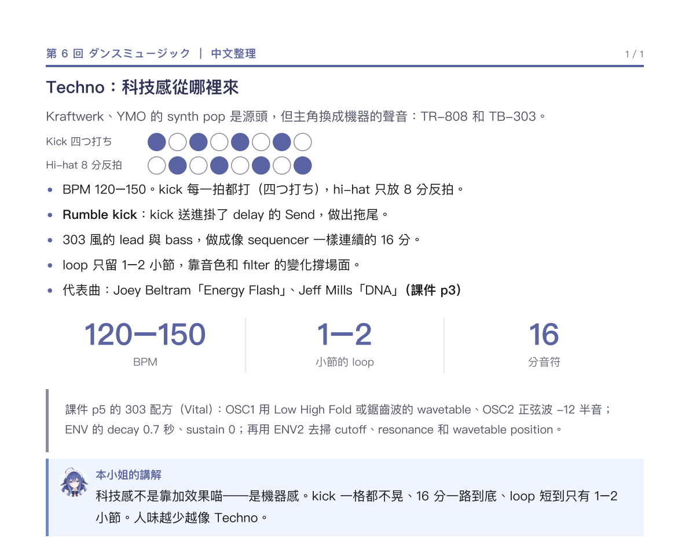

# 中文整理（dance-music）

**沒有原稿可以貼，那就把聲音畫出來。**

## 一句話

一頁一個風格。節奏用格子畫，重點用大數字，課件原文放引用框。

## 必須有

- **A4 直向。**
- **標題是一句判斷**（「Techno：科技感從哪裡來」），不是「第 6 回 ダンスミュージック」。
- **節奏格**：一拍一格，實心＝打、空心＝不打（Kick 四つ打ち、Hi-hat 8 分反拍）。
- **bullet 附課件頁碼**（`（課件 p3）`）。
- **大數字三格**：BPM／小節／分音符，豎線隔開。
- **引用框**：課件原文（配方），灰底、左邊一條線。
- **講解框**：收成一句「這風格為什麼這樣」。

## 絕對不要

- 只用文字描述節奏（「kick 打四下」）——要畫出來。
- 大數字超過三格，重點就散了。
- 引用框裡放自己的話——那裡是原文的位置。

## 參照

`DeepseekWorkspace/w6/第6回_舞曲節奏寫作_講義.pdf`（7 頁）

## 判斷

讀者不看原稿，也聽得懂這段在講哪種節奏。
