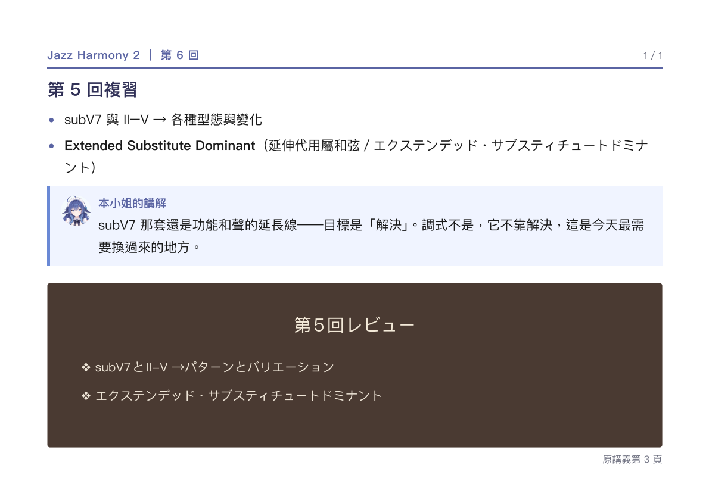

# 中文版講義（jazz-harmony）

**直向、一節一頁、原稿在下面。** 跟 sound-engineering 相反：那門課是橫式、原稿在上。

## 一句話

先讀中文，再往下對原稿。手指往下滑就對得到。

## 必須有

- **A4 直向。**
- **中文要點在上**（bullet，一節兩三條，短）。
- **講解框**接在要點後面。
- **原稿截圖在下**，右下角寫「原講義第 N 頁」。
- **術語英文優先，中文和日文放括號**：
  `Extended Substitute Dominant（延伸代用屬和弦／エクステンデッド・サブスティチュートドミナント）`。
  只留片假名，讀者要在腦裡多轉一次。

## 絕對不要

- 把原稿放上面（那是橫式那套的做法）。
- 中文照翻原稿。
- 一頁塞兩節。

## 參照

`Jazz Harmony2/6/第6回_中文版_Modes.pdf`（14 頁）

## 判斷

讀者先讀完中文，往下看原稿能不能對回同一頁。
