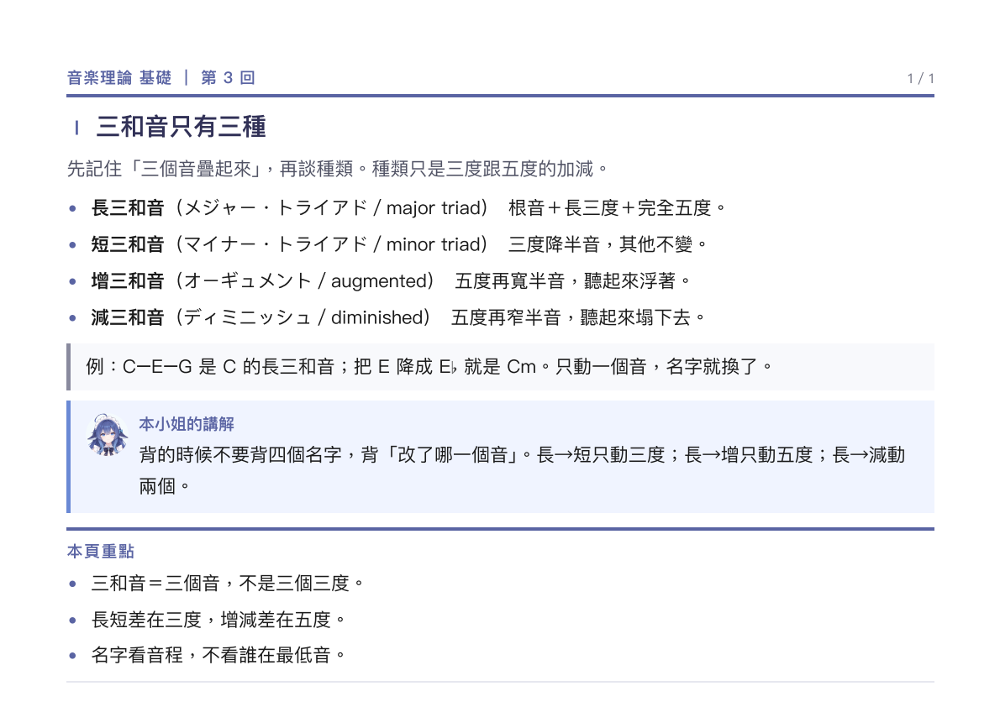

# 教材講解版（lesson-notes）

**把教材講成中文，加本小姐的聲音。** 一頁一件事，可以慢慢讀。

## 什麼時候用

- 材料是**教科書、課本頁、長講義**，不是投影片。
- 讀者要的是「為什麼」，不是「原文長什麼樣」。
- 可以花好幾天讀，不需要一眼掃完。

## 成品長相



A4 直向。三種頁：

**一、封面**
圓形頭像、課名、回數、一句話說明這回在幹嘛；下面署名與授權。

**二、內容頁**（主體）

```
┌────────────────────────────────┐
│ Ⅰ　先記住兩種建築形式            │ ← 標題，羅馬數字編號
│ 今天每一件作品，老師都會先問…     │ ← 導言，一句話
│                                │
│ ・重點一                        │
│ ・重點二                        │
│   └ 細節縮一層                  │
│                                │
│ ┌────────────────────────────┐ │
│ │ 本小姐的講解：…              │ │ ← 一頁最多一個
│ └────────────────────────────┘ │
│ ┌──────┐                       │
│ │ 圖   │ 圖說                   │
│ └──────┘                       │
└────────────────────────────────┘
```

**三、收尾頁**
重點框，最多四條。這一頁要帶走的東西。

## 參照

- [`examples/handout.pdf`](../../examples/handout.pdf)　這個 preset 的範例，可以直接改。
- [`examples/components.pdf`](../../examples/components.pdf)　四十多種元件，想換寫法的時候翻。
- 真實成品：9 頁（樂理課）、16 頁（程式數學的課本頁）、10 頁（歷史課圖解版）。
  同一套骨架，三種材料都撐得住。

## 規則

1. **一頁一件事。** 標題是一句斷言（「先記住兩種建築形式」），不是名詞（「建築形式」）。
2. **每頁開頭一句導言。** 告訴讀者這頁要幹嘛，不超過一行半。
3. **講解框一頁最多一個。** 放「原文沒說、但你需要知道的」，不是複述正文。
4. **術語原文優先。** 日文課留日文，後面括號中文；英文課留英文。
5. **圖少而精，一頁一張。** 寫實立繪和 Q 版不要疊在同一頁。
6. **最後一頁收四條以內。** 收不完代表這份還沒想清楚。

## 不做

- 不要把教材目錄照抄成頁序。目錄是教材的邏輯，不是讀者的邏輯。
- 不要每頁都塞滿。留白比塞滿好讀。
- 不要在講解框裡重複正文。
- 不要把「講得完整」當目標。
