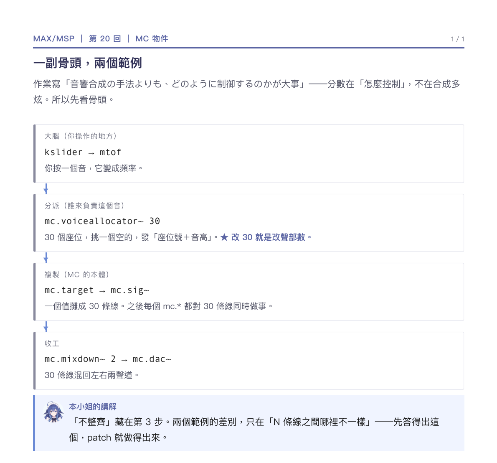

# handoff（max-msp）

**講 patch 怎麼接、怎麼改，就用這個。**

## 一句話

在圖上或清單裡找到編號，就知道那塊在幹嘛、哪裡可以動。

## 必須有

- **二選一**：
  - **標註過的大圖**：patch 截圖 + 虛線框 + ①–⑥ 編號，下面六條對照。
  - **節點鏈**：① ② ③ ④ 往下排，每個節點三行。
- **每個編號三件事**：角色名（「誰來唱」）＋物件名（等寬）＋一句話。
- **★ 標記可以動的參數**（`★ 改 30 就是改聲部數`）。
- **lede 先講「為什麼切成這幾塊」**。
- **最後一個講解框**：收成一句讀者該回答的問題。

## 絕對不要

- 貼整張 patch 叫人自己看。
- 逐物件寫成 API 文件——那是 help 檔的工作。
- 沒有「哪裡可以改」，讀者是要動手。

## 參照

`MAX:MSP/20/06_mc_fm_導覽.pdf`（1 頁，大圖版）、`20_MC骨架圖.pdf`（3 頁，節點鏈版）

## 判斷

讀者開著 Max，照編號能找到方塊、知道要動哪裡。
