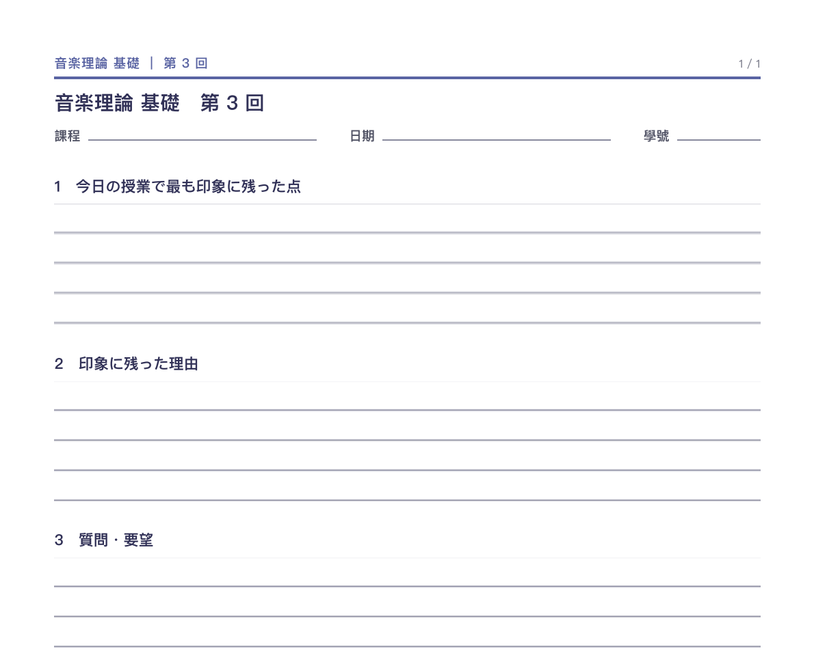

# 反應紙（reaction-paper）

**要交出去的那一張。**

## 什麼時候用

- 課堂反應紙（リアクションペーパー）、作業單、小考卷。
- 老師會收走、會打分。
- 需要手寫。

## 成品長相



A4 直向，**一頁**：

```
┌────────────────────────────────┐
│ 課名 ｜ 日期 ｜ 學號 姓名         │ ← 頁首
│                                │
│ ビザンティンの文化　6 世紀の建築   │ ← 題目照抄原文
│                                │
│ 1　授業で最も印象に残った点       │
│ ┌────────────────────────────┐ │
│ │                            │ │ ← 留白給手寫
│ │                            │ │
│ └────────────────────────────┘ │
│ 2　印象に残った理由              │
│ ┌────────────────────────────┐ │
│ │                            │ │
│ └────────────────────────────┘ │
└────────────────────────────────┘
```

## 參照

- [`examples/components.pdf`](../../examples/components.pdf)　「姓名欄」「練習題」這兩個元件就是這頁的骨架。
- 真實成品：一頁，三個題目 ＋ 書寫區，題目全日文。

## 規則

1. **題目照抄原文。** 日文就日文，不改寫、不翻譯在題目上。
2. **留白要夠手寫。** 一行不是一欄；至少要能寫三到四行字。
3. **頁首要課程資訊、日期、姓名欄。** 老師收去要對得上人。
4. **一頁解決。** 不加頁；真的寫不下就縮短題目，不是加頁。
5. **不加講解框。** 這是交出去的，不是給自己看的。

## 不做

- 不要印答案、提示、提示框。
- 不要加本小姐的註解。
- 不要把題目翻成中文——讀者看得懂題目，需要的是留白。
