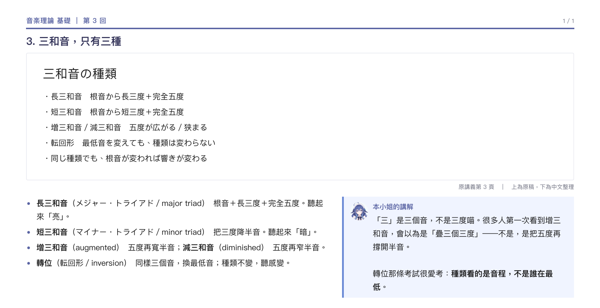

# 原稿對照版（sound-engineering）

**有原稿的課，一律這個做法。**

## 一句話

老師的投影片在上面看得到，中文在下面讀得到。讀者要能一邊指著原稿說「這段在講這個」。

## 必須有

- **A4 橫式，一節一頁。** 一節的原稿放一頁，不拆、不合併。
- **原稿截圖在上面**，裁掉白邊、放大到字看得清楚。
- **下面兩欄**：左邊中文要點，右邊「本小姐的講解」。
- **術語一律三對照**：「中文（日文／English）」。
  例：`長三和音（メジャー・トライアド／major triad）`。
- **最後一頁術語總表**，把整份的術語收在一起。
- **筆誤標「校勘」**：寫查證過的版本，查不到就說查不到。

## 絕對不要

- **片假名地獄。** 只留「オーギュメント」這種孤字，沒有中文、沒有英文。
- **把原稿濃縮成一張表。** 讀者是拿這份對照原稿看的，原稿要還在。
- **查不到就硬圓。** 寧可寫「這裡待查」。
- **一頁塞兩節。** 寧可多印一頁。

## 長相

上面一整塊原稿截圖；下面左邊要點、右邊講解。一頁就講這一節。

## 參照

- 真實成品：工作區 `Sound Engineering/第17回/`（13 頁，對照版）
- 版面：`templates/doc.css` 的 `@page doc`，橫式另外覆蓋 `@page`

## 判斷

把成品和原稿並排，讀者能不能在原稿上指出「這句話對應哪一段」。
指不出來，就是排太擠或翻太遠。
