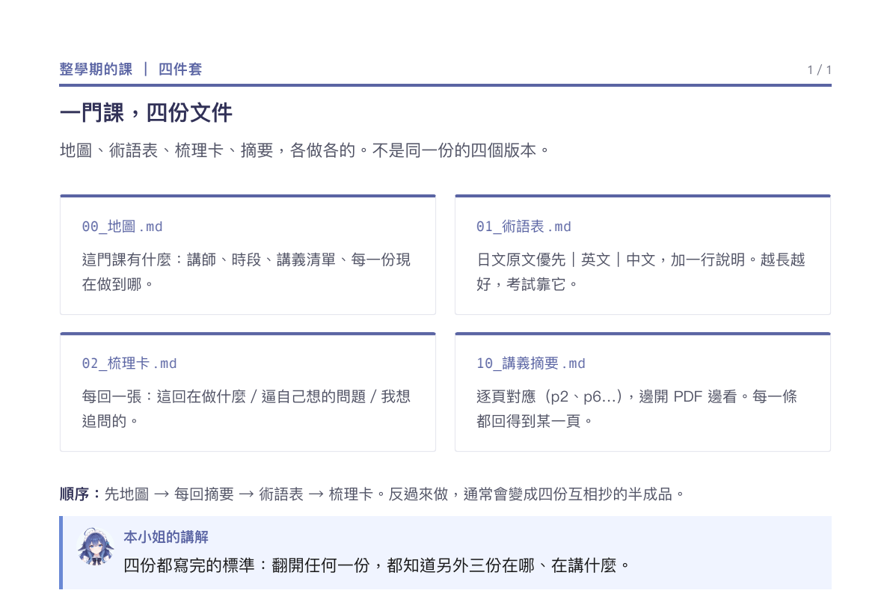

# 整理四件套（study-pack）

**四份文件把一門課撐起來。** 地圖、術語表、梳理卡、摘要，各做各的。

## 什麼時候用

- 一整個學期的課，會回頭查。
- 需要知道「我手上有什麼、學到哪、哪裡還不懂」。
- 不是一次讀完，是每天翻一點。

## 成品長相



四個 markdown，檔名固定：

| 檔名 | 內容 | 長度 |
|---|---|---|
| `00_地圖.md` | 這門課有什麼：講師、時段、講義清單、每份的進度 | 一頁 |
| `01_術語表.md` | 日文原文優先｜英文｜中文，加一行說明 | 越長越好 |
| `02_梳理卡.md` | 每回一張：這回在做什麼／逼自己想的問題／我想追問的 | 每回半頁 |
| `10_講義摘要.md` | 逐頁對應（p2、p5…），邊開 PDF 邊看 | 每回一節 |

`00` 是入口，另外三份是三個角度：**查**（術語）、**想**（梳理卡）、**讀**（摘要）。

```
00_地圖 ──┬── 01_術語表   查名字
          ├── 02_梳理卡   逼自己想
          └── 10_講義摘要  逐頁對照
```

## 參照

- 真實成品：一門樂理課的完整四件套。地圖寫到「雲端有什麼、你手上有沒有」，
  術語表每條四行，梳理卡每回五個問題，摘要逐頁標頁碼。
- 這四份是 markdown，不需要版面；要印再說。

## 規則

1. **術語表日文原文優先。** 英文和中文只幫你抓住意思，考試用的是日文。
2. **梳理卡的問題要能逼自己想。** 不要出「什麼是 X」這種查得到的；
   要出「為什麼改這個音」「換成別的做法還成立嗎」。
3. **摘要逐頁對應。** 寫「p6 授業目的：…」，不是「老師說…」。
   每一條都能回到 PDF 的某一頁。
4. **地圖寫「你手上有什麼」**，不是課程大綱。
5. **四份不要互相抄。** 各有各的職責，重複代表有一份沒想清楚。

## 不做

- 不要把四份寫成同一份的四個版本。
- 不要在術語表裡寫長篇解釋（一行說明就夠）。
- 不要用摘要取代梳理卡——一個是讀，一個是想。
- 不要一次寫完四份。先有地圖，再逐回長出另外三份。
