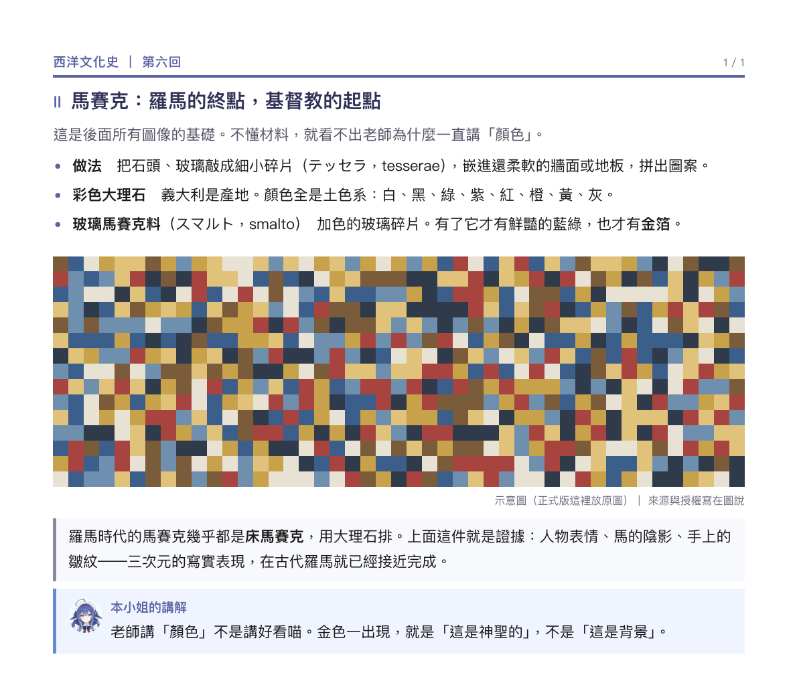

# 圖解講義（western-culture）

**材料是圖和日文講義，目的是看懂圖。**

## 一句話

封面先給一句總綱，每一頁用一張圖配一段解釋，圖的來源寫在圖說。

## 必須有

- **封面一句總綱。** 例：「羅馬人把馬賽克做到像照片；基督教把它變成黃金底上的符號。」
  後面九頁就是展開這句話。
- **每頁標題 + 導讀一句。**
- **`figure` + `figcaption`**：來源和授權寫在圖說（Wikimedia Commons、Public domain 之類）。
- **術語保留日文原文**（テッセラ、スマルト），後面括號中文。
- **例子框 + 講解框。** 例子框給「這張圖為什麼是證據」，講解框給「老師為什麼一直講這個」。

## 絕對不要

- **圖片不寫來源。** 下次要換圖、要引用，找不到出處。
- **圖和解釋分家。** 圖在上面、解釋在下一頁，等於沒有解釋。
- **把日文講義整段翻過來。** 讀者要的是看懂，不是譯文。

## 長相

標題 → 導讀 → 三條術語 → 一張大圖（含圖說）→ 例子框 → 講解。

## 參照

- 工作區 `西洋文化史/講義/第六回_ビザンティンの文化_講義.html`（10 頁）

## 判斷

不看圖也懂，看圖更懂。
只看圖不懂，就是圖說或解釋缺席。
